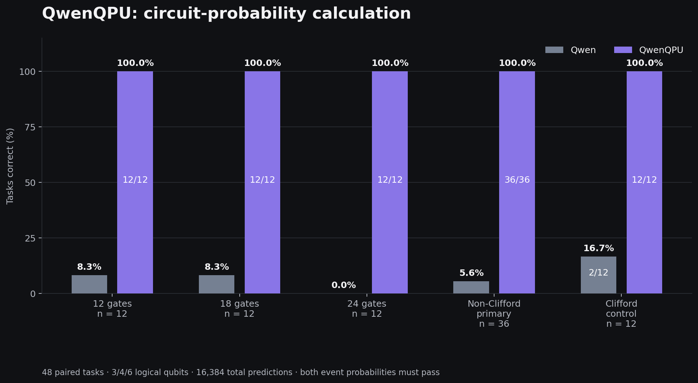
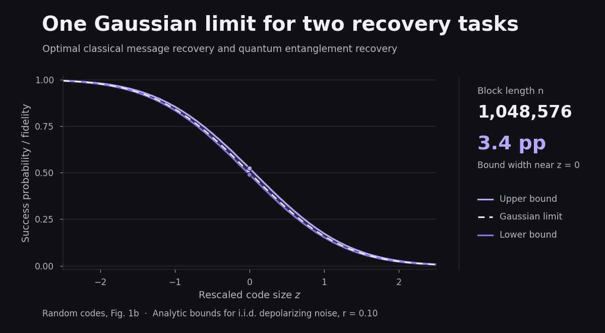
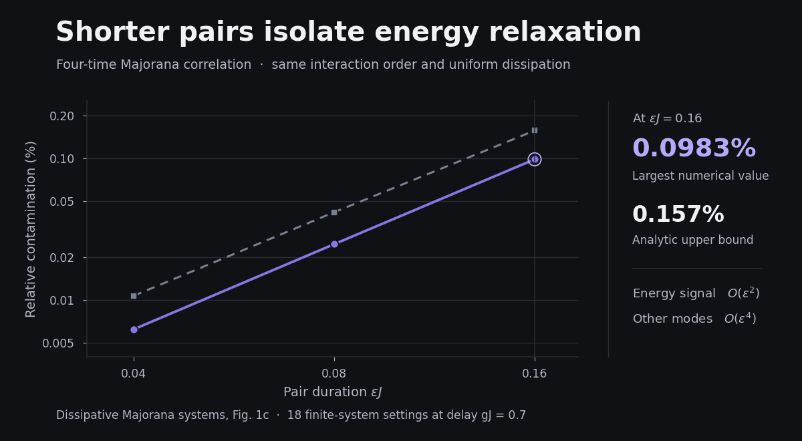
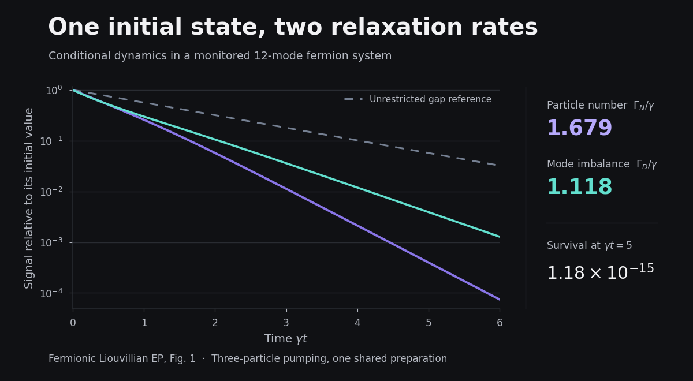
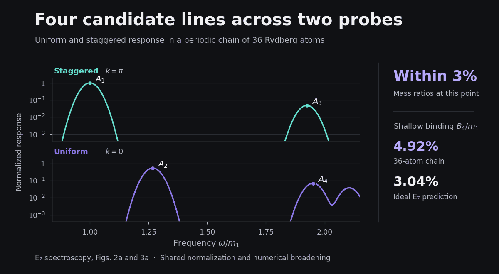
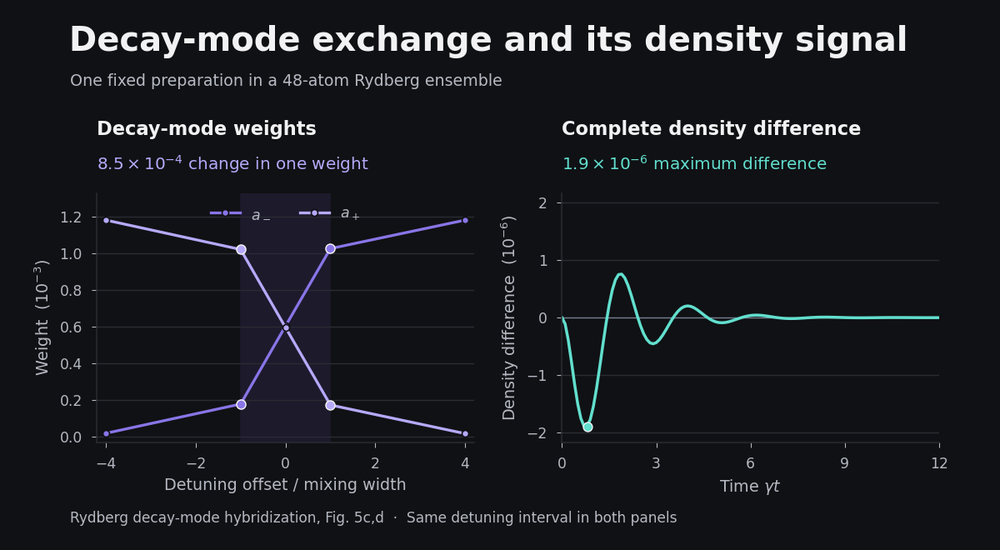

# OpenQuantum Papers

OpenQuantum 完成的六篇研究稿。从证明随机量子码的共同恢复规律，到把量子电路模拟器编进 Qwen 的权重，这里可以直接读到结果、推导与验证。

**[阅读六篇论文](#六篇论文)** · **[试用 OpenQuantum][openquantum-start]** · [English](#english)

## 六篇论文

### QwenQPU · 把量子电路模拟编进 Qwen

四个固定权重的标准 Qwen 层执行六比特量子电路的经典态矢量模拟，包括复振幅更新和测量概率读出。在同一语言模型上开启执行器，48 道固定测试的通过数从 **4/48 提升到 48/48**，相对 Qiskit 参考值的最大概率误差为 **1.42 × 10⁻⁵**。

[论文与附录][qwenqpu] · [实现与评测数据][qwenqpu-code]

*QwenQPU README 的原始评测图。48 个任务按门数和线路类型分组，两组使用相同语言权重和每题相同预测上限。*

### 随机量子码 · 经典与量子恢复共享一条临界曲线

对由精确酉 2-design 生成的随机码，给出 Pauli 噪声下经典整条消息读出与量子纠缠恢复的共同有限码长上下界。对满足条件的独立同分布噪声，在正码率临界窗口内，两种最优表现趋向**同一条高斯曲线**。

[论文][random-codes] · [补充材料][random-codes-si]

*论文图 1b 的解析界。码长增加时，临界中心附近的上下界间距从约 31.8 个百分点收窄到 3.4 个百分点。虚线是共同的高斯极限。*

### 耗散 Majorana 系统 · 用四时关联选出能量弛豫

在同阶相互作用和均匀耗散下，把四次费米子插入组成两对短时探针，并对全部组分求和。两对的时长同为 ε 时，能量信号是 ε² 阶，其他衰减模的贡献为 O(ε⁴)。论文给出了有限时间窗口内的误差界。

[论文][majorana] · [补充材料][majorana-si]

*论文图 1c 在同一延迟下的 18 组有限系统对照。成对时长为 0.16/J 时，数值最大污染约 0.0983%，理论上界约 0.157%。*

### 费米 Liouvillian 异常点 · 同一初态，两种衰减速率

从同一个初态出发，总粒子数和模式占据不平衡选中不同的衰减通道。对于只能读出保留系统或失败标记的实验，计入每次制备后，短时真空试验达到判别泵浦强度的最优制备次数标度。

[论文][fermion-ep] · [补充材料][fermion-ep-si]

*论文图 1 的 12 模对照。粒子数和不平衡的衰减率分别约为 1.679γ 和 1.118γ。在 γt = 5 时，保留样本比例约为 1.18 × 10⁻¹⁵。*

### Rydberg 链的 E₇ 谱 · 两种探针定位四条候选谱线

用均匀和交错探针把奇偶两个通道放到同一能标上。在严格阻塞模型的一个参数窗口内，四条低能候选峰的质量比与 E₇ 预测相差 **3% 以内**。最浅的 A₄ 候选在 36 原子工作点的结合能仍比理想值高约 62%，给出了有限链收敛的量化检验。

[论文][e7] · [补充材料][e7-si]

*论文图 2a 和图 3a 的 36 原子工作点。两个探针共用能标和强度归一化，A₄ 候选结合能为最低能隙的 4.92%，理想 E₇ 值为 3.04%。*

### 开放 Rydberg 系综 · 从衰减模交换算到密度信号

在平均场折点附近，追踪两个衰减模如何在避交叉处交换权重，并通过消去相干自由度复原谱根与观测权重。在固定制备的 48 原子对照中，单个模的权重变化约 **8.5 × 10⁻⁴**，完整密度信号的最大变化约 **1.9 × 10⁻⁶**。

[论文][rydberg-decay] · [补充材料][rydberg-decay-si]

*论文图 5c、d。左图标出的失谐区间用于右图的完整信号比较，两图纵轴分别以 10⁻³ 和 10⁻⁶ 为单位。*

## 用 OpenQuantum 做自己的计算

OpenQuantum 是开源量子科研 AI 平台，可在 Codex 或独立桌面应用中调用专业计算工具。可以从一段量子线路开始，用 Qiskit 模拟、用独立方法核对结果，再沿用同一工作区里的程序、参数和输出继续研究。

**[开始使用 OpenQuantum][openquantum-start]** · [查看可复跑的计算案例][openquantum-examples] · [OpenQuantum 主仓库][openquantum]

## English

Six research manuscripts by OpenQuantum, with PDFs and supplements linked below.

- [QwenQPU][qwenqpu] compiles a six-qubit classical state-vector simulator into four standard Qwen layers. Enabling execution raises the pass count from 4/48 to 48/48 on the frozen evaluation. [Code and data][qwenqpu-code]
- [Random-code recovery][random-codes] gives a joint finite-length bracket for optimal complete-message decoding and entanglement fidelity under Pauli noise. Both approach the same Gaussian curve in the positive-rate critical window for regular i.i.d. noise. [Supplement][random-codes-si]
- [Dissipative Majorana systems][majorana] use a four-time fermion correlation to select energy relaxation with a controlled finite-time remainder. [Supplement][majorana-si]
- [Fermionic Liouvillian exceptional points][fermion-ep] show how two observables select different relaxation channels from one initial state and establish the optimal preparation-cost scaling for pump discrimination with a system-or-erasure readout. [Supplement][fermion-ep-si]
- [Two-channel E₇ spectroscopy][e7] identifies four low-energy candidate lines in blockaded Rydberg chains and uses the shallow A₄ binding energy to quantify finite-size deviations. [Supplement][e7-si]
- [Rydberg decay-mode hybridization][rydberg-decay] connects the exchange of decay-mode weights near a mean-field fold to the density response under fixed preparations. [Supplement][rydberg-decay-si]

**[Explore OpenQuantum][openquantum]** for the open-source research workspace, installation options, and worked examples.

## 研究记录

[稿件版本与验证记录][manuscript-history] · [研究档案][research-archive] · [QwenQPU 稿件源码与图件][qwenqpu-tex]

[openquantum]: https://github.com/xi-zhao/OpenQuantum
[openquantum-start]: https://github.com/xi-zhao/OpenQuantum#快速开始
[openquantum-examples]: https://github.com/xi-zhao/OpenQuantum#使用与结果
[qwenqpu]: outputs/qwenqpu/paper/main.pdf
[qwenqpu-code]: https://github.com/xi-zhao/QwenQPU/tree/caae45327b46458163d0840a4c1466e5575a7b4f
[qwenqpu-tex]: https://github.com/xi-zhao/OpenQuantum-papers/tree/1749862c959b44dcc2810319ffeed74a725b08f9/outputs/qwenqpu
[random-codes]: outputs/prl-distinguishability/paper.pdf
[random-codes-si]: outputs/prl-distinguishability/supplement.pdf
[majorana]: outputs/prl-dissipative-syk/paper/main.pdf
[majorana-si]: outputs/prl-dissipative-syk/paper/supplement.pdf
[fermion-ep]: outputs/prl-highorder-ep/paper/manuscript.pdf
[fermion-ep-si]: outputs/prl-highorder-ep/paper/supplement.pdf
[e7]: outputs/e7-rydberg-prl/paper/e7_rydberg.pdf
[e7-si]: outputs/e7-rydberg-prl/paper/e7_rydberg_supplement.pdf
[rydberg-decay]: outputs/prl-chiral-switching/paper/main.pdf
[rydberg-decay-si]: outputs/prl-chiral-switching/paper/supplement.pdf
[manuscript-history]: https://github.com/xi-zhao/OpenQuantum-papers/blob/e9acbf31ee1391e5eb3890450744147d917461c0/README.md
[research-archive]: https://github.com/xi-zhao/OpenQuantum-papers/tree/c/import-research-papers
