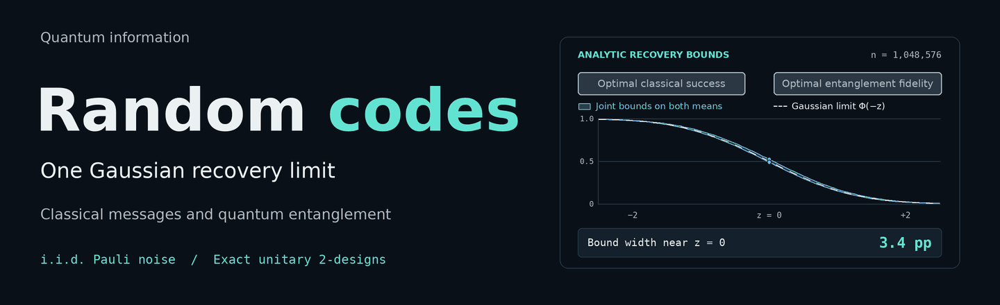
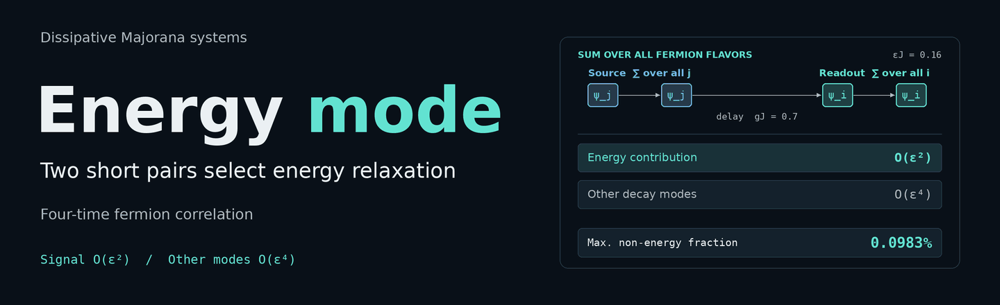
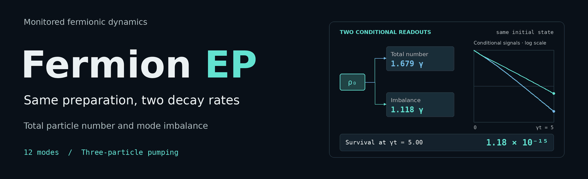
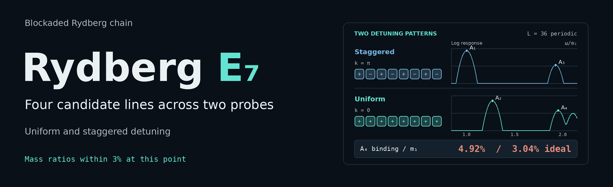
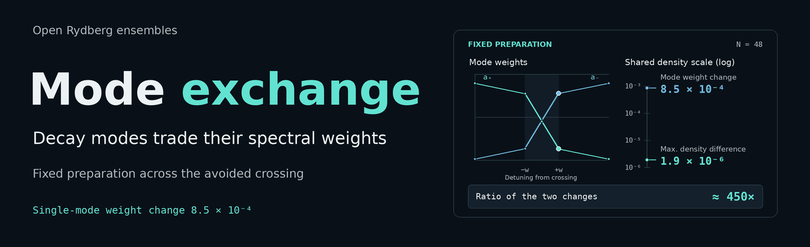

# OpenQuantum Papers

<a href="../../README.md">简体中文</a> · <a href="README.en.md">English</a> · <a href="README.ja.md">日本語</a> · <a href="README.ko.md">한국어</a> · <a href="README.es.md">Español</a> · <a href="README.fr.md">Français</a> · <a href="README.de.md">Deutsch</a> · <a href="README.pt.md">Português</a> · <strong>Русский</strong> · <a href="README.ar.md">العربية</a>

Шесть исследовательских работ OpenQuantum охватывают темы от общего закона восстановления для случайных квантовых кодов до симулятора квантовых схем, скомпилированного в веса Qwen. Здесь собраны результаты, выводы и записи проверок.

Пересчитайте основное состояние двухкубитной системы локально с помощью OpenQuantum и сравните энергию с независимым точным решением. Для этого примера ключ модели не нужен.

**[Читать шесть работ](#papers)** · **[Пересчитать основное состояние двух кубитов][openquantum-first-run]** · [Установить OpenQuantum][openquantum-start]

## Шесть работ

Статьи и приложения доступны в формате PDF на английском языке.

### QwenQPU · Симулятор квантовых схем внутри Qwen

Четыре стандартных слоя Qwen с фиксированными весами классически моделируют схемы на шести кубитах с помощью вектора состояния. Они обновляют комплексные амплитуды и считывают вероятности измерений. В той же языковой модели включение механизма исполнения увеличило число пройденных заданий в фиксированном тесте **с 4/48 до 48/48**. Максимальная абсолютная ошибка вероятностей относительно эталона Qiskit составила **1,42 × 10⁻⁵**.

[Статья и приложения][qwenqpu] · [Реализация и данные оценки][qwenqpu-code]

*Амплитуды и итоговая вероятность справа взяты из прогона стандартных слоёв Qwen.*

### Случайные квантовые коды · Общая критическая кривая восстановления классической и квантовой информации

Для случайных кодов из точного унитарного 2-дизайна получены общие верхняя и нижняя границы при конечной длине блока. Они ограничивают усреднённые по ансамблю оптимумы декодирования сообщения целиком и восстановления запутанности при шуме Паули. Для независимого одинаково распределённого шума, удовлетворяющего условиям регулярности, обе средние величины приближаются **к одной и той же гауссовой кривой** в критическом окне при положительной скорости кодирования.

[Статья][random-codes] · [Дополнительные материалы][random-codes-si]

*Вблизи центра критического окна ширина полосы уменьшается примерно с 31,8 до 3,4 процентного пункта на трёх длинах блока с рис. 1b.*

### Диссипативные системы Майораны · Четырёхвременная корреляция выделяет релаксацию энергии

При взаимодействиях фиксированного порядка и однородной диссипации четыре вставки фермионных операторов группируются в две пары с короткими временными интервалами. Каждую пару суммируют по всем компонентам. Если оба интервала равны ε, энергетический сигнал имеет порядок ε², а вклад остальных мод затухания имеет порядок O(ε⁴). В работе получена оценка ошибки на конечном интервале времени.

[Статья][majorana] · [Дополнительные материалы][majorana-si]

*В 18 конечных системах на рис. 1c при εJ = 0,16 и gJ = 0,7 максимальный вклад остальных мод относительно энергетического сигнала составил 0,0983 %.*

### Исключительные точки фермионного лиувиллиана · Две скорости затухания из одного начального состояния

Полное число частиц и дисбаланс заселённостей мод выделяют разные каналы затухания из одного начального состояния. Если считывание возвращает сохранившуюся систему или флаг стирания, короткие испытания с вакуумным состоянием достигают оптимального масштабирования числа подготовок, нужных для различения интенсивностей накачки. Учитывается каждая подготовка.

[Статья][fermion-ep] · [Дополнительные материалы][fermion-ep-si]

*В примере с 12 модами на рис. 1 скорости релаксации полного числа частиц и дисбаланса равны примерно 1,679γ и 1,118γ соответственно. При γt = 5 доля выживших реализаций составляет 1,18 × 10⁻¹⁵.*

### Спектроскопия E₇ в ридберговских цепочках · Четыре линии-кандидата с двумя зондами

Однородный и чередующийся зонды позволяют сравнить чётный и нечётный каналы на общей энергетической шкале. В одном диапазоне параметров модели со строгой блокадой отношения масс четырёх низкоэнергетических пиков-кандидатов отличаются от предсказаний E₇ **не более чем на 3 %**. В рабочей точке с 36 атомами энергия связи слабосвязанного кандидата A₄ примерно на 62 % выше идеального значения, что количественно характеризует отклонение для конечной цепочки.

[Статья][e7] · [Дополнительные материалы][e7-si]

*В расчёте для 36 атомов на рис. 2a и 3a энергия связи кандидата A₄ составляет 4,92 % от минимальной энергетической щели. Идеальное значение E₇ составляет 3,04 %.*

### Открытые ридберговские ансамбли · От обмена весами мод затухания к сигналу плотности

Вблизи точки складки решения среднего поля две моды затухания обмениваются весами при избегаемом пересечении. Исключение когерентностей позволяет восстановить корни спектрального уравнения и веса в наблюдаемой величине. В примере с 48 атомами при фиксированной подготовке вес одной моды меняется примерно на **8,5 × 10⁻⁴**, а максимальное изменение полного сигнала плотности составляет около **1,9 × 10⁻⁶**.

[Статья][rydberg-decay] · [Дополнительные материалы][rydberg-decay-si]

*Справа изменение веса на рис. 5c и максимальная разность плотности на рис. 5d показаны в одних единицах плотности. Между отмеченными расстройками эти величины различаются примерно в 450 раз.*

## Проводите свои расчёты с OpenQuantum

OpenQuantum — ИИ-платформа с открытым исходным кодом для квантовых исследований, доступная в Codex и как самостоятельное настольное приложение. Смоделируйте квантовую схему с помощью Qiskit, независимо проверьте результат и продолжите работу в том же пространстве с сохранённым кодом, параметрами и результатами.

**[Установить OpenQuantum][openquantum-start]** · [Посмотреть примеры для запуска][openquantum-examples] · [OpenQuantum на GitHub][openquantum]

## Исследовательские записи

[Версии рукописей и записи проверок][manuscript-history] · [Архив исследований][research-archive] · [Исходники рукописи и рисунки QwenQPU][qwenqpu-tex]

[openquantum]: https://github.com/xi-zhao/OpenQuantum/blob/main/docs/readme/README.ru.md
[openquantum-start]: https://github.com/xi-zhao/OpenQuantum/blob/main/docs/readme/README.ru.md#quick-start
[openquantum-examples]: https://github.com/xi-zhao/OpenQuantum/blob/main/docs/readme/README.ru.md#algorithm-learning-and-method-comparison
[openquantum-first-run]: https://github.com/xi-zhao/OpenQuantum/blob/main/docs/readme/README.ru.md#no-model-key-needed-recompute-a-fixed-case
[qwenqpu]: ../../outputs/qwenqpu/paper/main.pdf
[qwenqpu-code]: https://github.com/xi-zhao/QwenQPU/tree/caae45327b46458163d0840a4c1466e5575a7b4f
[qwenqpu-tex]: https://github.com/xi-zhao/OpenQuantum-papers/tree/1749862c959b44dcc2810319ffeed74a725b08f9/outputs/qwenqpu
[random-codes]: ../../outputs/prl-distinguishability/paper.pdf
[random-codes-si]: ../../outputs/prl-distinguishability/supplement.pdf
[majorana]: ../../outputs/prl-dissipative-syk/paper/main.pdf
[majorana-si]: ../../outputs/prl-dissipative-syk/paper/supplement.pdf
[fermion-ep]: ../../outputs/prl-highorder-ep/paper/manuscript.pdf
[fermion-ep-si]: ../../outputs/prl-highorder-ep/paper/supplement.pdf
[e7]: ../../outputs/e7-rydberg-prl/paper/e7_rydberg.pdf
[e7-si]: ../../outputs/e7-rydberg-prl/paper/e7_rydberg_supplement.pdf
[rydberg-decay]: ../../outputs/prl-chiral-switching/paper/main.pdf
[rydberg-decay-si]: ../../outputs/prl-chiral-switching/paper/supplement.pdf
[manuscript-history]: https://github.com/xi-zhao/OpenQuantum-papers/blob/e9acbf31ee1391e5eb3890450744147d917461c0/README.md
[research-archive]: https://github.com/xi-zhao/OpenQuantum-papers/tree/c/import-research-papers
