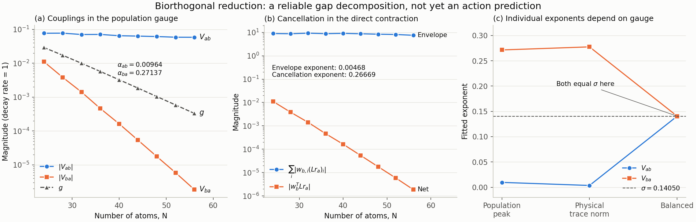

# 双正交两模约化：交叉矩阵元、相消与耦合指数

2026-10-28。参数：Ω=2、V=10、γ=1，N=24,28,…,56。本文是本轮计算记录，未改写论文及此前预注册文件；本轮属于探索性分析，没有新的盲测或预注册。

**结论：完成了可检验的双正交分解，得到有限尺寸拟合指数 α_ab=0.00964、α_ba=0.27137，以及 σ_fit=(α_ab+α_ba)/2=0.14050。尚未独立推出 σ=Φ(n_f)。** 在所选布居规范下，弱矩阵元包含相干分量之间的强抵消，单看右模布居尾部不足以得到它的指数。局域边界流给出了一个更具体的计算入口：接近折点的截面上，包络和抵消各贡献约 0.13–0.14；但这两个贡献依赖表示和截面，而且仍来自精确谱模，不能当作独立 WKB 预测。



## 1. 对象、基和规范

微观模型为

\[
H=-\Delta N_e+\Omega J_x+\frac{V}{2N}N_e(N_e-1),\qquad
L_i=\sigma_i^-.
\]

保留完整的置换不变算符空间，维数为 \(\binom{N+3}{3}\)，包括局域衰减耦合的所有 Dicke 块。生成元对失谐线性：

\[
\mathcal L(\Delta)=\mathcal L_0+\Delta\mathcal L_1,
\qquad \mathcal L_1\rho=i[N_e,\rho].
\]

在每个尺寸的实间隙驻点 \(\Delta_*\) 求两条实衰减模的左右本征矢。左列向量使用转置对偶：

\[
\mathcal L_*R=R\Lambda,\quad W^T\mathcal L_*=\Lambda W^T,
\quad W^TR=I.
\]

此处转置不是遗漏共轭；数值上求解的是 \(\mathcal L_*^T\) 的本征问题。对于保厄米的实参数生成元，将两条实模相位对齐并厄米化后再投影。PIQS 中右密度块已汇总自旋表示的重数，左向量是该存储约定的对偶；不能给左向量再乘一套重数。

对 \(W^T\mathcal L_1R\) 对角化，得到固定的局部 diabatic 基 \(R_d,W_d\)，使

\[
H_P(\delta)=W_d^T\mathcal L(\Delta_*+\delta)R_d
=\begin{pmatrix}e_a+s_a\delta&A\\ B&e_b+s_b\delta\end{pmatrix},
\quad A=V_{ab},\ B=V_{ba}.
\]

a 是较小绝对斜率支，b 是较大绝对斜率支。这是操作性标签，不以布居图单独证明它们的动力学身份。固定剩余的幅度自由度为

\[
\max_k |\operatorname{Tr}(\Pi_k r_i)|=1.
\]

最大绝对布居的符号取正。非零衰减模迹为零，布居有正负；它们不是正密度矩阵。此规范只定义“相同最大布居扰动”的单位，且对纯相干模会退化。本次两个模式的布居均非零。

## 2. 可以严格推导的关系

在投影点，二维子空间不变，因此两条精确本征值之差 d 满足

\[
d^2=(e_a-e_b)^2+4AB.
\]

投影同时精确重现一阶参数导数，故

\[
\left.\partial_\Delta d^2\right|_{\Delta_*}
=2(e_a-e_b)(s_a-s_b).
\]

两条本征值在邻域内为实数、间距非零且 \(s_a\ne s_b\) 时，真实间隙驻点要求 \(e_a=e_b\)，从而

\[
\boxed{g_N^2=V_{ab}V_{ba}},\qquad g_N=d/2.
\]

这在驻点是谱投影的恒等式，不是对间隙的独立预测。对数关系给出

\[
\boxed{\sigma=\tfrac12(\alpha_{ab}+\alpha_{ba})}
\]

——当渐近指数存在时成立；同一组 N 上的线性拟合斜率也满足相同关系。本轮只报告后者，没有证明渐近指数存在。

在偏离投影点时，应考虑 Q 空间。令 \(P=R_dW_d^T, Q=I-P\)，精确 Feshbach 有效矩阵为

\[
H_{\rm eff}(z,\delta)=H_P(\delta)+
\delta^2W_d^T\mathcal L_1Q
[z-Q(\mathcal L_*+\delta\mathcal L_1)Q]^{-1}_{Q}
Q\mathcal L_1R_d.
\]

Q 修正从二阶开始，但不自动比指数小的 B 更小。本轮在 \(|\delta|\le2g/|s_a-s_b|\) 的四个实轴采样点独立重新求谱：二维模型对半间隙的最大相对误差在 N=40 为 0.139%，N=56 为 0.0137%。这支持所测窗口的局部约化，不是对复参数 EP 或整个 Q 预解式的严格误差界。

## 3. 数值结果与有限尺寸拟合

下面为新双精度生成元的结果；旧数据保留在原文件中。

| N | Δ_* | V_ab | V_ba | g_N |
|---:|---:|---:|---:|---:|
| 24 | 3.137403 | 0.0769610 | 1.114978×10⁻² | 2.929332×10⁻² |
| 28 | 3.175763 | 0.0774375 | 3.849007×10⁻³ | 1.726434×10⁻² |
| 32 | 3.205748 | 0.0706601 | 1.416164×10⁻³ | 1.000332×10⁻² |
| 36 | 3.230029 | 0.0710046 | 4.630050×10⁻⁴ | 5.733716×10⁻³ |
| 40 | 3.250225 | 0.0650646 | 1.637006×10⁻⁴ | 3.263604×10⁻³ |
| 44 | 3.267370 | 0.0634070 | 5.391916×10⁻⁵ | 1.849013×10⁻³ |
| 48 | 3.282163 | 0.0614787 | 1.773599×10⁻⁵ | 1.044215×10⁻³ |
| 52 | 3.295094 | 0.0587806 | 5.889385×10⁻⁶ | 5.883719×10⁻⁴ |
| 56 | 3.306521 | 0.0585377 | 1.871404×10⁻⁶ | 3.309798×10⁻⁴ |

拟合约定：\(\ln|V|=c-\alpha N\)，不加固定幂次的预因子。它们是随 \(\Delta_*(N)\) 漂移的有效斜率，不是某个固定 Δ 的作用量。

| N 窗口 | α_ab | α_ba | σ_fit |
|---|---:|---:|---:|
| 24–56 | 0.00963768 | 0.27136532 | 0.14050150 |
| 32–56 | 0.00892133 | 0.27534527 | 0.14213330 |
| 40–56 | 0.00717953 | 0.27892588 | 0.14305270 |

局部 σ 从 N=24→28 的 0.13218 增至 N=52→56 的 0.14383。因而不宜将 0.14050 写成已收敛的无限尺寸常数。V_ab 变化缓慢，数据与次指数预因子相容，但不能凭有限区间证明 α_ab→0。

## 4. 单项指数的规范依赖

若 \(r_i\to c_i r_i, w_i\to c_i^{-1}w_i\)，则

\[
A\to(c_b/c_a)A,\qquad B\to(c_a/c_b)B.
\]

乘积不变，单项不变性仅限于相对归一化为次指数的规范。用物理算符范数再次核对：右模使用完整自旋空间的迹范数，左模使用完整可观测算符的算符范数。PIQS 的重数约定使前者等于各已汇总 Dicke 块迹范数之和，后者等于各左块最大算符范数。

| 归一化，N=24–56 拟合 | α_ab | α_ba | 两者平均 |
|---|---:|---:|---:|
| 最大布居扰动为 1 | 0.00964 | 0.27137 | 0.14050 |
| 右模物理迹范数为 1 | 0.00356 | 0.27744 | 0.14050 |
| 人为平衡两交叉元 | 0.14050 | 0.14050 | 0.14050 |

平衡规范采用 \(c_b/c_a=\sqrt{|B/A|}\)，两个指数相等是构造结果。前两种自然幅度约定都显示明显不对称，但仍不能赋予单项指数规范无关的意义。布居规范下，右模物理迹范数在 N=24→56 从 (49.23,20.09) 增至 (85.33,29.63)，左模算符范数从 (0.130,1.276) 增至 (0.181,2.646)。本次范围没有出现左模总体范数携带另一份约 0.14 的指数增长。

## 5. 直接矩阵元的相消：为什么尾部图不够

精确收缩为

\[
B=\sum_i w_{b,i}(\mathcal Lr_a)_i
 =\sum_{ij}w_{b,i}\mathcal L_{ij}r_{a,j}.
\]

在 N=40，将第一种求和按输出算符条目是否为对角元分类：

\[
B_{\rm diagonal}=0.9659542705123,\quad
B_{\rm coherence}=-0.9657905698872,
\]

\[
B=0.0001637006251.
\]

在 N=56，两部分为 0.7879492686787 和 −0.7879473972747，净值只有 1.8714×10⁻⁶。这不是一个只在折点布居峰上发生的正权重相乘过程。

| N | \(\sum_i|w_{b,i}(\mathcal Lr_a)_i|\) | 净值 B | 行求和相消比 |
|---:|---:|---:|---:|
| 24 | 8.95719 | 1.114978×10⁻² | 8.03×10² |
| 32 | 9.30132 | 1.416164×10⁻³ | 6.57×10³ |
| 40 | 9.10738 | 1.637006×10⁻⁴ | 5.56×10⁴ |
| 48 | 8.39761 | 1.773599×10⁻⁵ | 4.73×10⁵ |
| 56 | 7.54740 | 1.871404×10⁻⁶ | 4.03×10⁶ |

N=24–56 的行求和包络指数为 0.00468，相消因子贡献 0.26669，合计 0.27137。逐稀疏矩阵条目求和的相消比更大，N=56 为 6.43×10⁸。

**这个相消分配不是新的物理不变量。** 对偶正交性使任意标量 c 都满足

\[
w_b^T\mathcal Lr_a=w_b^T(\mathcal L-cI)r_a.
\]

取 c=e_a，并使用精确不变子空间关系，得到

\[
(\mathcal L-e_a)r_a=B r_b.
\]

这时收缩的包络/净值比只有约 6–7；原来巨大的相消被转移到求残差的步骤中。对 WKB 而言，真正困难的是算出这个超出主导局部本征方程的指数小残差。若右模已经来自精确本征对子空间，上式不能再用作独立预测 B 的依据。

左右模在 n_f 的剖面也不提供唯一作用量：高支右模的“对角元最大值”拟合衰减指数约 0.14555，而先对相同激发数求和的布居扰动指数约 0.12101；左 b 模的对角最大值在该点缓慢增长（拟合指数 −0.01205）。剖面的聚合方式、相干信息和投影残差均会影响推断。

## 6. 边界流恒等式：将问题限制到一个截面

为避免体积项抵消，引入对压缩算符坐标的截断 \(\chi\)：

\[
\chi_{ii}=\mathbf1\!\left[\frac{k_{\rm row}+k_{\rm col}}{2N}\le n_c\right].
\]

该 χ 是算符坐标掩码，不是密度矩阵的物理投影或概率事件；相干条目也有明确归属。局域稀疏生成元的对易子 \([\chi,\mathcal L]\) 只保留跨截面条目。定义

\[
J_{ab}=w_a^T[\chi,\mathcal L]r_b,\qquad
D_i=w_i^T\chi r_i,\qquad O_{ab}=w_a^T\chi r_b.
\]

由双正交约化直接得到

\[
J_{ab}=(e_b-e_a)O_{ab}+V_{ab}(D_a-D_b).
\]

在间隙驻点，

\[
\boxed{V_{ab}=\frac{J_{ab}}{D_a-D_b}},\qquad
\boxed{V_{ba}=\frac{J_{ba}}{D_b-D_a}}.
\]

这将计算交叉元的问题转化成左右模在截面上的带符号通量和双正交权重。使用八个截面 n_c=0.157,0.18,0.22,0.26,0.30,0.34,0.38,0.42，所有尺寸的重构最大相对误差为 1.6×10⁻⁸。它仍是用精确模式验证的恒等式，但比体积重叠更适合作为独立渐近匹配的起点。

在 n_c=0.157（接近 n_f=0.156927）处，由于离散网格，实际边界为不大于 n_c 的最后一个 \((k_{row}+k_{col})/(2N)\)，本次范围约 0.1429–0.1563，不能声称精确取到 n_f。

| N | D_b−D_a | 跨边界绝对项之和 | 净通量 J_ba | 相消比 |
|---:|---:|---:|---:|---:|
| 24 | 0.67186 | 2.18161 | 7.49110×10⁻³ | 291 |
| 32 | 0.73662 | 1.15956 | 1.04318×10⁻³ | 1112 |
| 40 | 0.68796 | 0.29059 | 1.12619×10⁻⁴ | 2580 |
| 48 | 0.72365 | 0.13195 | 1.28347×10⁻⁵ | 10281 |
| 56 | 0.68556 | 0.02941 | 1.28296×10⁻⁶ | 22925 |

将通量写为 \(J=\mathcal A\mathcal C\)，其中 \(\mathcal A=\sum|t_{ij}|\)，\(\mathcal C=\sum t_{ij}/\sum|t_{ij}|\)。在 N=24–56 上：

\[
\beta_{\mathcal A}=0.13123,\quad
\beta_{|\mathcal C|}=0.13942,\quad
\beta_{D_b-D_a}=-0.00072.
\]

因此

\[
\alpha_{ba}=\beta_{\mathcal A}+\beta_{|\mathcal C|}-\beta_{D_b-D_a}
=0.27137.
\]

包络和相消各接近一份 0.14，这是一条可检验的线索。它不是两份相同作用量的证明：在 n_c=0.22，两项变成 0.06632 和 0.20360；在 n_c=0.30 则是 0.01137 和 0.25778，总和经分母校正后保持同一 α_ba。不能通过挑选一个截面把它们定义成两份 Φ。n_c=0.157 的窗口变化也明显：32–56 为 (0.14426,0.13264)，40–56 为 (0.13429,0.14340)。

## 7. 从理论到 σ：目前达到的程度

若从生成元、局部模式边界条件和匹配条件独立构造左右 WKB 模

\[
r_a(x)\asymp a_a(x)e^{-NS_a(x)},\qquad
w_b(x)\asymp b_b(x)e^{-NT_b(x)},
\]

则边界通量需要计算包含相干坐标、计数熵和符号/相位的和或积分。不能直接将所有项取绝对值：即使零能 Hamilton–Jacobi 方程相同，有限衰减模和稳态也可以选择不同分支，并有不同的输运与连接系数。

对固定规范、固定截面，若各极限存在，定义

\[
S_{\rm env}=-\lim N^{-1}\ln\mathcal A,
\quad S_{\rm cancel}=-\lim N^{-1}\ln|\mathcal C|,
\quad S_D=-\lim N^{-1}\ln|D_b-D_a|.
\]

由边界恒等式得到

\[
\boxed{\sigma=\frac12\bigl(\alpha_{ab}+S_{\rm env}+S_{\rm cancel}-S_D\bigr)}.
\]

本轮给出了这个公式的有限尺寸数值分解，但其中的 S 仍由精确谱模提取。真正独立的推导必须不使用待预测间隙，求出带相位的边界通量或高支准模的泄漏残差。若 A 次指数、分母次指数，而只证明包络含 \(e^{-N\Phi}\)，还不能得到 σ=Φ；没有额外相消时得到的将是 σ=Φ/2。需要独立解释为什么净通量获得第二份指数代价，或者证明主导鞍点本来就具有不同作用量。

稳态激发数边缘 \(\Phi(n)\) 已把相干及其他自由度消去；它不包含上述全部信息。本轮因此**不支持把“右尾部与 ghost 模的重叠就是 g”作为推导**，也没有排除经验关系 σ≈Φ(n_f)。还缺少的是衰减模带符号通量的渐近计算，而不是更多次重现 g²=AB。

## 8. 数值精度、限制及复现

本轮发现 QuTiP 5.3.1 PIQS 的 `_piqs.pyx` 中 gamma2 等局域衰减系数的中间变量使用 C `float`；最终 complex128 存储不会恢复已损失精度。新脚本复用同一 gamma1–gamma4 公式，以 float64 计算，仅支持本任务的单位局域衰减，没有修改安装库或旧脚本。

- N=56，旧生成元的迹保持缺陷为 4.74×10⁻⁷，新实现为 7.11×10⁻¹⁵。
- N=1,2,3,4，与独立完整自旋 Lindblad 构造在正交对称 Pauli 基上的谱比较，最大误差低于 4.5×10⁻¹⁴；保厄米和迹保持检查通过。
- 九个尺寸的左右本征对绝对残差均低于 1.6×10⁻¹²，双正交误差低于 1.3×10⁻¹²；投影子空间残差最高约 5.8×10⁻¹¹。
- g²=AB 的对角失谐修正占比低于 1.1×10⁻¹⁷；投影半间隙与精确本征差的最大绝对偏差约 1.5×10⁻¹²。
- N=40、56 使用不同 ARPACK 随机种子和 shift（−0.76→−0.80）复算，g 相对差低于 3.4×10⁻¹⁰，V_ba 相对差低于 2.8×10⁻¹⁰。左、右同一生成元的本征残差不能检出生成元本身的单精度误差，因此另做上述双精度和完整自旋验证。
- 双精度将 N=56 的 g 从 0.0003260261 修正到 0.0003309798（+1.52%）；整体拟合 σ 从 0.1406242 修正到 0.1405015。其他 Ω、先前复参数 EP 和论文图尚未用新实现重算，不能把这里的精度结论推广过去。
- Accelerate 的复数 `matmul` 在有限随机矩阵上也报告除零/溢出/无效警告，但结果与显式 `einsum` 相对差约 4.2×10⁻¹⁵。本轮关键密集收缩使用 `einsum(optimize=False)`；最终谱审计文件无该警告。没有仅靠屏蔽警告来宣布收敛。

依赖为本机已有 Python 3.13.2、NumPy 2.2.6、SciPy 1.16.3、QuTiP 5.3.1、Matplotlib；没有新增安装。输入、版本和旧 gN.json 的 SHA-256 见 `data/biorthogonal_audit/inputs.json`。旧谱只用作驻点初值和比较，新驻点由双精度模型重新细化。

从本报告所在目录执行：

```bash
VECLIB_MAXIMUM_THREADS=1 OPENBLAS_NUM_THREADS=1 OMP_NUM_THREADS=1 python3 code/biorthogonal_validate.py
```

```bash
VECLIB_MAXIMUM_THREADS=1 OPENBLAS_NUM_THREADS=1 OMP_NUM_THREADS=1 python3 code/biorthogonal_audit.py 40 --refine --vectors
```

将上条命令的 N 替换为 24,28,…,56，可再生九个主数据文件；预先存在的向量文件使以下分析可直接复现。

```bash
VECLIB_MAXIMUM_THREADS=1 OPENBLAS_NUM_THREADS=1 OMP_NUM_THREADS=1 python3 code/biorthogonal_analysis.py
```

```bash
VECLIB_MAXIMUM_THREADS=1 OPENBLAS_NUM_THREADS=1 OMP_NUM_THREADS=1 python3 code/biorthogonal_flux.py
```

```bash
python3 code/biorthogonal_figure.py
```

主要机器可读结果：`analysis.json`（窗口拟合、规范、左右剖面、相干分解、局部谱）、`boundary_flux.json`（所有截面）、`N*_float64_*.json`（残差及矩阵）、同名 `.npz`（左右模式）。所有文件均在 `data/biorthogonal_audit/`，图的数据对应本报告表格及这些 JSON。
