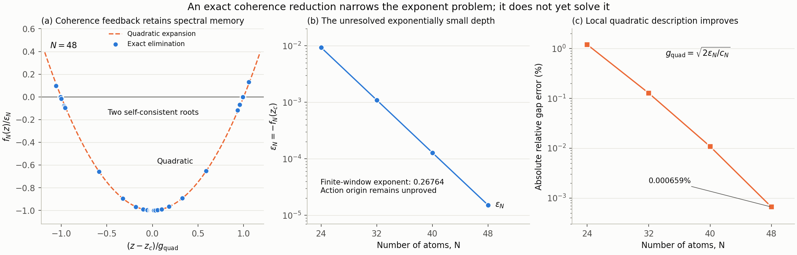

# 从双正交耦合到相干消元：指数机制研究记录

日期：2026-10-28。模型参数：局域衰减率 γ=1、Ω=2、V=10。

本轮建立并验证了一个精确的有限尺寸谱约化：逐层消去非零相干阶数后，两条衰减本征值成为同一条、依赖谱参数的有效本征支的两个自洽根。局部二次展开把半间隙写成

\[
 g_N\simeq \sqrt{\frac{2\epsilon_N}{c_N}}.
\]

这里的极小值深度 \(\epsilon_N\) 具有清楚的有限尺寸指数衰减，但它的作用量来源仍未推导出来。因此，本轮缩小了需要解释的对象，**没有独立推出 \(\sigma\simeq0.14\)，也没有证明 \(\sigma=\Phi(n_f)\)**。

所用交叉位置 \(\Delta_*(N)\) 来自上一轮完整谱计算，谱搜索窗口也来自已有模态信息。连分式求根不输入完整生成元的左右本征矢，不用已知间隙决定根；它仍然是另一种有限 \(N\) 谱求解方式，不是无需谱计算的大 \(N\) 预测。



## 1. 延续上一轮已经建立的事实

微观模型为

\[
 H=-\Delta N_e+\Omega J_x+\frac{V}{2N}N_e(N_e-1),
 \qquad L_i=\sigma_i^-.
\]

计算空间是维数 \(\binom{N+3}{3}\) 的置换不变算符空间，包含所有 Dicke \(j\) 块及局域衰减导致的块间耦合。下文“完整生成元”均指此 PI 空间，不声称覆盖其他置换对称性扇区的全谱。

上一轮在真实半间隙驻点建立了双正交两模基，并得到

\[
 g_N^2=V_{ab}V_{ba}.
\]

在布居峰值规范下，\(N=24,28,\ldots,56\) 的有限窗口指数为

\[
 \alpha_{ab}=0.009638,\quad
 \alpha_{ba}=0.271365,\quad
 \sigma=0.140501.
\]

单个矩阵元指数依赖模态归一规范；乘积与指数和不依赖。上述等式使用精确谱子空间，因此是谱恒等式，不是独立的作用量推导。细节见 [双正交报告](BIORTHOGONAL_REPORT_2026-10-28.md)。

## 2. 两条直接路线没有给出有效预测

### 相干分组没有显示简单奇偶律

对弱边界流，固定截面 \(n_c=0.157\)，分别按 signed coherence \(q\)、总自旋块及跨界方向求和。以 \(N=40,56\) 为例：

| N | 净弱通量 | 逐条目绝对值和 | 按 q 求和后的绝对值和 | 按 j 求和后的绝对值和 |
|---:|---:|---:|---:|---:|
| 40 | 1.12619×10⁻⁴ | 0.290588 | 0.0263040 | 0.00355158 |
| 56 | 1.28296×10⁻⁶ | 0.0294124 | 0.00219304 | 0.000225382 |

相消存在于多个层次。两个方向的净贡献在 \(N=40\) 约为 −0.00741269、+0.00752531，在 \(N=56\) 约为 +0.000622776、−0.000621493；甚至方向符号也改变。

本次检查不支持用单一 \((-1)^q\) 因子直接解释弱耦合的额外指数。这不是对所有复相位或 Stokes 结构的数学排除。上一轮已经说明，通量包络与相消因子的指数分别依赖截面，不能将它们各自认作一份不变的 \(\Phi\)。

### 硬截断分区模严重依赖人为边界

在已知 \(\Delta_*(N)\)，以布居坐标截断生成元，在两侧各取接近 −0.76 的局部实衰减模，再计算跨区矩阵元。\(N=40\) 的结果：

| 截面 | 两侧局部本征值 | \(\sqrt{V_{ab}V_{ba}}\) |
|---:|---|---:|
| 0.157 | −0.761879、−0.960476 | 0.0745990 |
| 0.22 | −0.805383、−0.673067 | 纯虚数，乘积约 −0.0184928 |
| 0.26 | −0.916218、−0.893756 | 0.105542 |
| 0.30 | −0.691376、−0.882150 | 0.553206 |

真实半间隙为 0.00326360。硬边界改变了局部谱，两侧也没有处于共振，局部模身份未经独立确认，所以此处的平方根本来就不具备真实半间隙的含义。它排除了这项未经边界匹配的简单近似，不能排除带正确边界条件的 WKB 局部模方法。

原始分组与全部局部候选谱保存在 [phase_partition.json](data/coherence_mechanism/phase_partition.json)。

## 3. 按相干阶数的精确 Schur 连分式

对算符基元 \(|j,m\rangle\langle j,m'|\)，定义 signed coherence \(q=m-m'\)。对角哈密顿量与局域发射保持 \(q\)，驱动对易子只连接 \(q\) 与 \(q\pm1\)。因此生成元按 \(q\) 呈块三对角形式。

记

\[
 A_q=L_{q,q},\quad U_q=L_{q,q+1},\quad D_q=L_{q+1,q}.
\]

从最高正相干阶数 \(Q=N\) 开始消元：

\[
 \Sigma_Q(z)=0,\qquad
 \Sigma_{q-1}(z)=U_{q-1}[zI-A_q-\Sigma_q(z)]^{-1}D_{q-1}.
\]

对实物理参数和实 \(z\)，负 \(q\) 链与正 \(q\) 链互为复共轭。于是 \(q=0\) 有效算符为

\[
 K_N(z)=A_0+2\operatorname{Re}\Sigma_0(z),\qquad
 K_N(z)r_0=zr_0.
\]

这里 \(q=0\) 保留所有 Dicke 块的对角条目；它不是只剩激发数 \(k\) 的边缘概率方程。\(K_N(z)\) 也不保证是经典 Markov 生成元。

令 \(P\) 投影到 \(q=0\)，\(Q=I-P\)。当 \(z-L_{QQ}\) 可逆时，

\[
 \det(zI-L)=\det(zI-L_{QQ})\det[zI-K_N(z)].
\]

逐层连分式还要求每一个中间消元分母可逆。极点附近不能直接使用这条求根过程；纯相干、\(r_0=0\) 的模式可能位于被消去扇区。设置 \(q_{\max}<N\) 则只对相干截断矩阵精确。

**实轴限制必须保留。** 对实 \(\Delta\)、复 \(z\)，负链是 \(\overline{\Sigma_+(\bar z)}\)，不能写成 \(2\operatorname{Re}\Sigma_+(z)\)。当前程序主动拒绝复 \(z\) 和复失谐，不用于直接寻找复参数 EP。

这是标准 Schur 消元在本模型的应用，不把连分式或消元方法本身作为创新性主张。

## 4. 两个自洽根与局部二次展开

在所检查的实轴局部窗口，取有效算符的简单实本征支 \(\mu_N(z)\)，定义

\[
 f_N(z)=\mu_N(z)-z.
\]

其极小点 \(z_c\) 满足

\[
 f_N(z_c)=-\epsilon_N<0,\quad
 f_N'(z_c)=0,\quad c_N=f_N''(z_c)>0.
\]

二次展开给出

\[
 f_N(z)=-\epsilon_N+\frac{c_N}{2}(z-z_c)^2+\cdots,
 \qquad g_{N,\mathrm{quad}}=\sqrt{\frac{2\epsilon_N}{c_N}}.
\]

四个尺寸的结果如下。误差定义为 \(g_{\mathrm{quad}}/g-1\)。

| N | 输入 Δ* | ε | c | 完整谱半间隙 g | 二次近似相对误差 |
|---:|---:|---:|---:|---:|---:|
| 24 | 3.1374029518 | 9.3340390×10⁻³ | 22.28695 | 0.02929331517 | −1.20023% |
| 32 | 3.2057477750 | 1.0961896×10⁻³ | 21.96534 | 0.01000331556 | −0.127729% |
| 40 | 3.2502246066 | 1.2842211×10⁻⁴ | 24.11955 | 0.003263603686 | −0.0108421% |
| 48 | 3.2821625250 | 1.5168879×10⁻⁵ | 27.82335 | 0.001044214986 | −0.000658911% |

直接对连分式方程求两个根，与完整谱半间隙的相对差分别为 \(4.43\times10^{-13}\)、\(-1.79\times10^{-11}\)、\(-1.91\times10^{-11}\)、\(-1.25\times10^{-9}\)。二次近似的误差应与这些求根误差分开。

极小点不等于两个根的中点。例如 \(N=24\)：

\[
 z_c=-0.7455027591,\quad
 z_-=-0.7802041069,\quad z_+=-0.7216174765.
\]

中点为 −0.7509107917，两根并不关于 \(z_c\) 对称。故不能将 \(z_c\) 直接当作两模平均衰减率。更不能把 \(f_N'(z_c)=0\) 称为 EP：当前 \(f_N(z_c)\ne0\)，这个点根本不是本征值。

冻结 \(K_N(z_c)\) 后，\(N=48\) 的邻近本征值约为 −0.75910208、−0.21846755、0，没有原始生成元的那一对接近的实根。两根来自依赖 \(z\) 的自洽方程，而不是冻结矩阵的一对近邻本征值。

对应的时域消元是

\[
 \dot x_0(t)=L_{00}x_0(t)+L_{0Q}e^{tL_{QQ}}x_Q(0)
 +\int_0^t L_{0Q}e^{(t-s)L_{QQ}}L_{Q0}x_0(s)\,ds.
\]

因此这里的谱参数依赖确实对应被消去相干自由度的记忆效应。此结果说明冻结这一个消元算符会失去目标根对；它不排除其他经过正确匹配的有效两模模型。

### 与完整模双正交范数的精确联系

这个消元还给出一条连接上一轮双正交分析的恒等式。写

\[
 G=(zI-L_{QQ})^{-1},\quad B=L_{0Q},\quad C=L_{Q0},
 \quad K=L_{00}+BGC.
\]

在简单有效本征支上取 \(l^Tr=1\)，构造

\[
 R=\begin{pmatrix}r\\GCr\end{pmatrix},\qquad
 W^T=(l^T,\ l^TBG).
\]

因为 \(K_z=-BG^2C\)，故

\[
 \boxed{W^TR=l^T(I-K_z)r=1-\mu_z=-f_z.}
\]

此式作为回代向量的代数配对在该分支上成立；但只有 \(f(z)=0\) 时，\(R,W\) 才是完整 \(L\) 的左右本征模。一般地，

\[
 (L-zI)R=\begin{pmatrix}f(z)r\\0\end{pmatrix},\qquad
 W^T(L-zI)=(f(z)l^T,0).
\]

因此极小点 \(f_z=0\) 的回代向量可以自正交，同时不是本征模。这不能作为当前点为 EP 的证据。

若消元无极点、\(K(z_c)\) 的相关本征值代数简单，并且同时满足 \(f=f_z=0\)、\(f_{zz}\ne0\)，则局部 \(\det(zI-L)=-h(z)f(z)\)、\(h(z_c)\ne0\)。完整特征多项式有二重零点，核空间经 Schur 回代仍是一维，才得到 EP2。这个条件性结论用完整 Schur 算子的解析延拓，不把代码中的 `2 Re Sigma` 当作复解析表达式。它精确联系了自洽斜率和双正交自正交性，仍不决定 \(\epsilon_N\) 的指数。

## 5. 解析曲率与有限尺寸指数

令 \(G_q=(zI-A_q-\Sigma_q)^{-1}\)、\(E_q=I-\Sigma_q'\)。递推求导为

\[
 \Sigma_{q-1}'=-U_{q-1}G_qE_qG_qD_{q-1},
\]

\[
 \Sigma_{q-1}''=U_{q-1}
 [2G_qE_qG_qE_qG_q+G_q\Sigma_q''G_q]D_{q-1}.
\]

对简单实本征支取 \(l^Tr=1\)、\(l^Tr'=0\)，则

\[
 \mu'=l^TK'r,
 \quad (K-\mu I)r'=-(K'-\mu'I)r,
 \quad \mu''=l^TK''r+2l^TK'r'.
\]

二阶式通过带归一约束的线性系统求 \(r'\)，避免用极小值附近的相消差分估算曲率。这里所有导数都是对 \(z\)，不是对 \(\Delta\)。

对四个点 \(N=24,32,40,48\)，定义有限窗口指数 \(\alpha_X=-\mathrm{slope}[\ln X\text{ vs }N]\)，得到

\[
 \alpha_\epsilon=0.2676351,\qquad
 \alpha_c=-0.00948974,
\]

\[
 \sigma_{\mathrm{quad}}=\frac{\alpha_\epsilon-\alpha_c}{2}
 =0.1385624,\qquad
 \sigma_g=0.1390296.
\]

较大两个尺寸 \(40\to48\) 给出

\[
 \sigma_{\mathrm{quad}}=0.1424331,\qquad
 \sigma_g=0.1424458.
\]

所以不能简单将 0.267635 除以二当作最终 \(\sigma\)：有限尺寸曲率变化和非二次项仍有影响。这个四点窗口与上一轮 \(24\!:\!4\!:\!56\) 的窗口不同，数值不能混称同一次拟合。尚无证据证明 \(c_N\) 渐近只含幂律前因子，也没有证明这四点确定了 \(\epsilon_N\) 的渐近作用量。

## 6. 相干截断与数值有效性

相干截断保留 \(|q|\le q_{\max}\)。它不是新的 CPTP 模型；低截断下“最靠近 −0.76 的两个实模”也可能已不是目标模，因此保留了全部候选谱。

| qmax | N=40 半间隙相对误差 | N=56 半间隙相对误差 |
|---:|---:|---:|
| 8 | +5.1873 | +165.17 |
| 10 | +0.35523 | +24.376 |
| 12 | +0.025262 | +3.7778 |
| 14 | −1.7038×10⁻⁴ | +0.65009 |
| 16 | −8.491×10⁻⁵ | −2.278×10⁻⁵ |
| 20 | −1.453×10⁻⁵ | +2.35×10⁻⁷ |
| 24 | −5.66×10⁻⁷ | −1.83×10⁻⁶ |

误差不单调；某个截断的半间隙偶然准确，不表示两个绝对本征值、其他谱或整个动力学都准确。这些数值反对将低阶相干反馈直接忽略，不提供 \(q_{\max}\) 随 \(N\) 的渐近误差定理。

本轮验证包括：

- 四个尺寸的八个根均从 \(q=0\) 回代成完整 PI 右本征模；最大 \(\|Lr-zr\|_2/\|r\|_2=1.14\times10^{-13}\)，归一化迹小于 \(8.2\times10^{-14}\)。
- 两根上的中间消元分母，最小一范数倒条件数估计在 \(4.33\times10^{-4}\) 至 \(1.73\times10^{-3}\) 之间。它支持已计算根处的稳定性，不证明整个复平面或整个搜索区间无极点。
- \(N=24\) 的算符解析一、二阶导数与步长 \(10^{-4}\) 的中心差分相对差为 \(3.65\times10^{-8}\)、\(1.53\times10^{-7}\)。
- 四个尺寸极小点的 \(|f'|<2.3\times10^{-12}\)，本征方程与导数方程残差小于 \(5.1\times10^{-13}\)。
- 独立数学核查确认块结构、实轴消元和导数公式；同时发现并修复两种通用求根误报。最近本征支跳跃使 Brent 在无根区间误报收敛时，程序现在按最终残差拒绝；具有非零虚部的 LAPACK 本征值也不会被丢弃虚部后当作实根。
- 验证反例包含 \(K=\operatorname{diag}(-0.80,-0.72)\) 在无根区间 \([-0.78,-0.74]\) 的跳支，以及 \(-0.75\pm10^{-9}i\) 的复本征对。两者均被拒绝，正常光滑实根被接受。

程序仍然使用局部最近支选择，不宣称实现了全局解析分支追踪。残差小是数值一致性证据，在非正规问题中本身不是严格的前向误差界；这里还结合了独立完整谱比较和回代检查。

## 7. 高支到折点的瞬子候选：本轮没有收敛结果

另一个探索候选是

\[
 \sigma_\infty\stackrel{?}{=}\frac12 S_{\mathrm{high}\to\mathrm{fold}}.
\]

它的动机是某些规范下一个交叉方向缓慢变化、另一个方向指数受抑；此动机不构成推导。尤其是当前有限 \(N\) 交叉位于 \(\Delta_*<\Delta_f\)，而高支到鞍点的延拓从双稳区 \(\Delta>\Delta_f\) 接近折点，二者如何匹配尚未建立。

复用已有精确相干态 Hamiltonian，规范约化到三组正则变量 \((n,u,v;p_n,p_u,p_v)\)。Hamiltonian 的动量二次型不正定，因此以下仅寻找延续的驻定路径，不能直接称正定扩散问题的全局最小作用量。

结果与失败均保留：

| 方法 | Δ | 返回 action | 收敛诊断 | 本轮判断 |
|---|---:|---:|---|---|
| 变分方程雅可比 shooting | 3.8 | 0.18588355 | section mismatch 4.29×10⁻⁷ | 仅满足本轮 10⁻⁶ 探索阈值 |
| 同上 | 3.78 | 0.19262924 | mismatch 4.33×10⁻⁷ | 同上，未到折点 |
| 同上 | 3.76 | 0.16797669 | mismatch 0.34898 | 失败，不使用 action |
| 固定端点配点，T≈36.79 | 3.8 | 0.18588353 | 超网格上限，max rms≈8.52×10⁻⁶ | 失败 |
| 流形边界配点，tol=2×10⁻⁷ | 3.8 | 0.18588352 | 超网格上限，max rms≈6.71×10⁻⁶ | 失败 |
| 流形边界配点，tol=10⁻⁵ | 3.8 | 0.18588421 | 超网格上限，max rms≈1.03×10⁻⁴ | 失败 |

缩短时长至 \(T\simeq18.40\) 的配点也失败，端点动量、能量与残差更差。进程正常退出不代表路径求解成功；这里以 `ok`、求解器状态和 mismatch 为准。能量误差小也不能代替两段路径的正确匹配。

因此没有 \(S_{\mathrm{fold}}\) 的有效估计，不做折点外推，不用未收敛 action 拟合或解释 0.14。本轮没有新预注册，也没有修改历史预注册阈值。

## 8. 文献位置与剩余理论问题

Hérau、Hitrik、Sjöstrand 的 [Tunnel effect for Kramers–Fokker–Planck type operators](https://arxiv.org/abs/math/0703684) 摘要给出：在双极小值、单鞍点的 Morse 结构及额外条件下，最低两个本征值的隧穿分裂可作指数精细分析。本轮只核对其摘要，不声称复现该证明。该结论不是本模型有限衰减激发模交叉的现成定理。

已有量子开放系统 instanton/switching 工作也不能被改称本轮方法创新。本轮可以保留的贡献是模型中的可验证谱结构与精确约化，以及由它明确指出的下一项理论对象。

尚缺的是：从微观生成元或等价的半经典问题独立确定 \(\epsilon_N/c_N\) 的指数，证明它与正确的边界匹配、左模或作用量有关，并在未用于建立关系的参数上预测结果。将有限尺寸 \(\epsilon_N\) 再拟合成指数不能满足这个标准。

## 9. 数据来源与复现

主要文件：

- [coherence_fraction.py](code/coherence_fraction.py)：实轴精确连分式及局部求根。
- [coherence_fraction_derivatives.py](code/coherence_fraction_derivatives.py)：解析谱参数导数与二次近似。
- [coherence_validate.py](code/coherence_validate.py)：回代残差、消元条件数、导数与求根失败路径。
- [coherence_recurrence.py](code/coherence_recurrence.py)：相干阶数截断谱。
- [coherence_phase_audit.py](code/coherence_phase_audit.py)：相干分组和硬截断模测试。
- [fold_escape_continuation.py](code/fold_escape_continuation.py)、[fold_escape_bvp.py](code/fold_escape_bvp.py)：未到折点的瞬子尝试。
- [analysis.json](data/coherence_mechanism/analysis.json)：数值表、有限窗口拟合、失败记录索引、版本与输入 SHA256。
- [validation.json](data/coherence_mechanism/validation.json)：本轮最终验证和源文件 SHA256。

`fraction_N24_q24.json` 由本轮较早、使用固定求根端点 −0.81、−0.71 的版本生成；随后 N=40 暴露远端复分支问题，才改为从极小点向两侧局部扩展括号。其他三个尺寸使用局部括号。原始 fraction/derivative 文件也早于最终求根保护；它们的八个根已由最终版本重新回代验证。保留原始采样记录，不假装它们逐行出自最终版本。

部分旧 BVP 结果文件名未写容差；其默认容差为 2×10⁻⁷，显式放宽的结果另存为 `fold_bvp_manifold1_scale1_tol1e-05.json`。所有失败记录均保留。

下列命令从仓库根目录执行。Python/NumPy/SciPy/QuTiP/Matplotlib/SymPy 使用当前已安装环境，没有新增依赖。

```bash
VECLIB_MAXIMUM_THREADS=1 OPENBLAS_NUM_THREADS=1 OMP_NUM_THREADS=1 python3 outputs/prl-chiral-switching/code/coherence_validate.py
```

```bash
VECLIB_MAXIMUM_THREADS=1 OPENBLAS_NUM_THREADS=1 OMP_NUM_THREADS=1 python3 outputs/prl-chiral-switching/code/coherence_fraction.py 40
```

```bash
VECLIB_MAXIMUM_THREADS=1 OPENBLAS_NUM_THREADS=1 OMP_NUM_THREADS=1 python3 outputs/prl-chiral-switching/code/coherence_fraction_derivatives.py 40
```

```bash
python3 outputs/prl-chiral-switching/code/coherence_analysis.py
```

```bash
python3 outputs/prl-chiral-switching/code/coherence_figure.py
```

以上求根/导数命令重新运行会更新对应输出。当前提交保留这次研究实际产生的数据及其历史说明；没有改写论文正文、补充材料或旧预注册。
