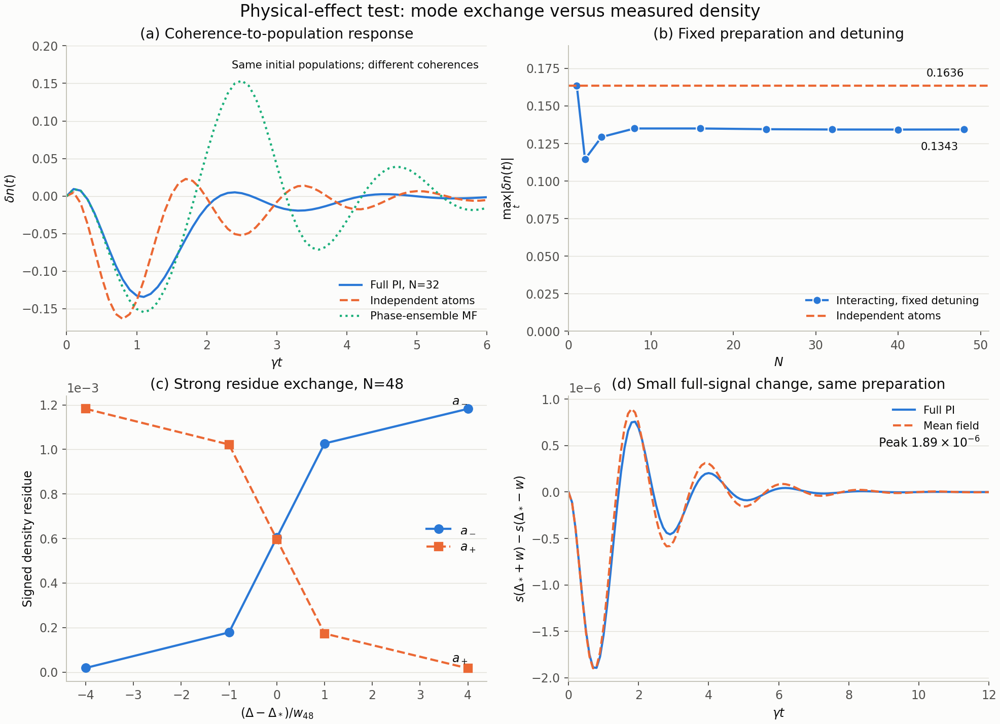

# 物理效应检验：模态交换没有转化为强人口开关

日期：2026-11-01。检验设计见 [PHYSICAL_EFFECT_TEST_2026-11-01.md](PHYSICAL_EFFECT_TEST_2026-11-01.md)。本轮使用已有交叉位置、完整置换不变生成元和相同物理制备，新增独立对照；没有覆盖旧谱、相干响应、预注册、失败瞬子、稿件或来源清单。

## 科学结论

**在所测的两种制备、激发密度观测、N=24–48 与 0≤γt≤12 内，没有发现由近简并实模对带来的强窄交叉响应或随尺寸增强的相干转人口峰值。** 单模残数明显交换，但完整人口信号变化平滑；微小分裂自身在两模总响应中的附加形状很小。这个阴性结果限制当前的 PRL 候选物理主张，不否定谱混合，也不排除其他制备、观测量或驱动协议。

另一方面，完整瞬态仍可明显偏离公平的平均场与无相互作用对照。因此本轮不能得出“所有响应都只是单原子效应”或“平均场已经解释完整动力学”。尚未被平均场解释的部分，也没有被本轮归因于这对实模。



[矢量图 PDF](figs/physical_effects_2026-11-01_v2.pdf) · [图中数值表 CSV](figs/physical_effects_2026-11-01_v2.csv)。图 (a,b) 使用固定 fold 相干差，(c,d) 使用 N=48 交叉点冻结的高支差分制备；所有纵轴保留原始密度单位。图 (c) 是带符号谱残数，不是可测概率；图 (d) 才是固定制备下两侧完整信号的差。曲线连接用于引导视线，不是额外拟合。

## 1. 公平对照与计算范围

- Ω=2γ、V=10γ，逐原子独立衰减；保留全部置换不变 Dicke 块及局域衰减块间转移。
- 第一制备为 ρ_f−D_Ne(ρ_f)：同一个 fold 单原子状态的乘积与其全局激发数去相干态之差。全局相位平均保留 q=0 块，并不等同于逐原子独立去相干。
- 第二制备为高支真实弛豫方向上的 ±0.005 乘积态差；在每个尺寸的交叉点构造，然后在该尺寸的全部失谐扫描中固定。该高支种子随 N 改变，不把它直接解释成跨尺寸固定资源比较。
- 交叉扫描 N=24、32、40、48；每个尺寸取 δ=0、±w_N、±4w_N、±0.06，共 28 点，其中 w_N=2g_N/|s_a−s_b| 使用原有斜率与半间距。±4w 与 ±0.06 并非在所有尺寸都按同一远近顺序排列。
- 另在同一绝对失谐 Δ=Δ_*(32)=3.205747774994305γ，使用相同单原子制备参数，计算 N=1、2、4、8、16、24、32、40、48。
- 所有时间序列使用 γt=0,0.1,…,12。峰值均指这 121 个采样点的最大幅值，未宣称连续时间精确极值。没有除去衰减包络。
- V=0 基线保持裸失谐与驱动；另作冻结初始 Hartree 场匹配，Δ_free=Δ−V(N−1)n_seed/N。对密度这个一体观测量，V=0 的多体动力学准确约化为单原子 Bloch 方程，即使全局去相干态保留关联。
- 平均场对照对共同随机相位的产品态分别演化，再平均结果，并保留有限 N 因子 V(N−1)/N。直接演化初始平均向量 (n_f,0,0) 会使用不同的关联结构，本轮未采用该不公平比较。

原始记录：[effects_2026-11-01.json](data/physical_effects/effects_2026-11-01.json)。先运行的 N=24 小样本保留为 [pilot_2026-11-01.json](data/physical_effects/pilot_2026-11-01.json)。这不是将新扫描用于重新优化交叉位置。

## 2. 0.134 的相干响应不是多体增强证据

在 Δ=Δ_*(32)、相同 fold 制备下：

| 情况 | 最大采样人口差 | 峰值时刻 γt |
|---|---:|---:|
| V=0 精确单原子基线 | 0.1636293 | 0.8 |
| N=32、V=10 完整 PI | 0.1343027 | 1.1 |
| N=32 初始 Hartree 匹配的 V=0 基线 | 0.1447327 | 1.2 |

因而“大幅相干转人口”本身不足以识别近简并实模。Hartree 匹配进一步表明，不能把相互作用引起的简单初始共振移动当成该谱对的特殊效应。

固定 Δ=Δ_*(32) 的尺寸检查：

| N | 最大采样人口差 | 初态迹距离 D₀ |
|---:|---:|---:|
| 1 | 0.1636293 | 0.32814 |
| 4 | 0.1293140 | 0.55907 |
| 8 | 0.1349900 | 0.68136 |
| 16 | 0.1349931 | 0.77071 |
| 24 | 0.1345022 | 0.80829 |
| 32 | 0.1343027 | 0.83076 |
| 40 | 0.1342664 | 0.84645 |
| 48 | 0.1343079 | 0.85816 |

N=8–48 的峰值基本稳定在 0.134 附近，没有观察到随尺寸显著增大的峰值。初态迹距离却随 N 增大，故也不能用固定单原子种子来声称“相同全局制备资源”。本轮只记录该资源差异，不定义最优测量任务或精密度增益。

## 3. 残数交换很强，完整响应变化很小

固定制备后，比较 Δ_*−w_N 与 Δ_*+w_N。高支差分信号的结果为：

| N | w_N/γ | 两侧完整信号最大差 | 两侧差的 L² 范数 / 中央信号 L² 范数 |
|---:|---:|---:|---:|
| 24 | 0.0264910 | 8.1281×10⁻⁵ | 6.914% |
| 32 | 0.00747047 | 2.2984×10⁻⁵ | 1.938% |
| 40 | 0.00212925 | 6.5658×10⁻⁶ | 0.552% |
| 48 | 0.000612960 | 1.8941×10⁻⁶ | 0.159% |

以 N=48 为例，(a_−,a_+) 从约 (0.00017833,0.00102207) 变为 (0.00102681,0.00017316)。单条模权重改变约 8.5×10⁻⁴，但两侧完整密度信号最大差只有 1.89×10⁻⁶。两者单位相同，含义不同：残数属于模态分解，后者才是实际制备与观测下的信号变化。

fold 相干差的完整两侧差幅值在 N=24、32、40、48 分别为 0.0156967、0.00527436、0.00170909、0.000545548；也随所考察混合宽度缩小。仅凭宽度变窄且差变小，不能排除变化很尖但幅值很小的特征，因此下一节进一步检查实际参数导数。

## 4. 无拟合的完整生成元导数预测

在交叉中心固定初态，直接传播 y₀=x(t)、y₁=∂_Δx(t)、y₂=∂²_Δx(t)：

\[
\dot y_0=Ly_0,\quad
\dot y_1=Ly_1+L_1y_0,\quad
\dot y_2=Ly_2+2L_1y_1,
\]

初值为 (x,0,0)。这一块下三角传播没有使用两侧曲线拟合，也没有作两模截断。用中心的一阶、二阶导数预测 δ=±w_N 的信号，二阶预测在两侧的最大相对 L² 误差为：

| N | fold 相干差 | 高支差分 |
|---:|---:|---:|
| 24 | 2.32×10⁻⁴ | 1.03×10⁻⁵ |
| 32 | 7.54×10⁻⁶ | 1.79×10⁻⁷ |
| 40 | 2.34×10⁻⁷ | 4.11×10⁻⁹ |
| 48 | 7.11×10⁻⁹ | 9.95×10⁻¹¹ |

高支响应在各尺寸中心的 max_t|∂_Δs| 约为 0.001534、0.001538、0.001542、0.001545，未随 1/w_N 增长。fold 相干差对应值为 0.2964、0.3530、0.4013、0.4450，有温和增长，但远小于混合宽度倒数的增长。这些是有限尺寸观测，不拟合渐近指数。

因此所测完整信号在窄混合宽度内可以由平滑局部变化准确解释。**该导数来自完整生成元，包含所有模态；它不能证明平均场有效，也不能把谱对从完整动力学中“去除”。** 小于约 10⁻¹² 的绝对差只作数值一致性记录，不解释为可达到的实验精度。

原始记录：[sensitivity_2026-11-01.json](data/physical_effects/sensitivity_2026-11-01.json)。

## 5. 微小分裂自身的附加形状

令 λ_±=−κ±g，κ>g>0；对当前物理制备与人口观测的残数定义 A=a_−+a_+、B=g(a_+−a_−)。精确的两模总和为

\[
S_2(t)=e^{-\kappa t}\left[A\cosh(gt)+B\frac{\sinh(gt)}g\right].
\]

与保留相同 A、B、κ 的 S₀(t)=e^{−κt}(A+Bt) 比较。由 cosh x−1≤x²eˣ/2、sinh x−x≤x³eˣ/6（x≥0），得到

\[
|S_2-S_0|\le g^2e^{-(\kappa-g)t}
\left(\frac{|A|t^2}{2}+\frac{|B|t^3}{6}\right).
\]

进一步分别对 t²e^{−at} 与 t³e^{−at} 取最大值得到全部 t≥0 的保守界：

\[
\sup_t|S_2-S_0|\le g^2\left[
\frac{2|A|}{e^2(\kappa-g)^2}
+\frac{9|B|}{2e^3(\kappa-g)^3}\right].
\]

fold 相干差的数值为：

| N | 0≤γt≤12 最大采样差 | 全时间解析上界 |
|---:|---:|---:|
| 24 | 6.06×10⁻⁵ | 8.18×10⁻⁵ |
| 32 | 7.94×10⁻⁶ | 1.04×10⁻⁵ |
| 40 | 9.14×10⁻⁷ | 1.18×10⁻⁶ |
| 48 | 9.98×10⁻⁸ | 1.29×10⁻⁷ |

N=48 的 A≈−0.21987、B≈0.029505，并未在这些样本中随 1/g 发散。此处将 A、B 固定只用于比较同一个谱对的两种表达，**不是**说实际改变物理系统时 A、B 也保持不变。

S₀ 并非本轮构造的 CPTP 替代系统，也不是对完整演化的误差界、量子计量优势界或普遍不可检测性定理。它说明：在这对谱模已经贡献的响应内，分辨其非零分裂所需的额外形状信息很小；谱对整体仍可能贡献非指数瞬态。已存有限率双重态与 Jordan 型响应先例 [Molina 2026](https://doi.org/10.21468/SciPostPhysCore.9.3.045) 已有相关近简并展开，不能把上述 Taylor 估计宣称为新一般理论。

## 6. 完整物理信号的收缩界

对固定物理态差 x=ρ_a−ρ_b，D₀=||x||₁/2，观测 O=N_e/N 满足 0≤O≤I。实失谐下 T_Δ(t)=e^{tL_Δ} 为 CPTP，且 ∂_ΔL=i[N_e,·]。Duhamel 公式与 Hermitian 算符的迹范数收缩给出

\[
|\partial_\Delta s(t)|\le NtD_0,\qquad
|\partial_\Delta^2s(t)|\le N^2t^2D_0.
\]

说明：对迹零 Hermitian Y，有 |Tr(OY)|≤||Y||₁/2；对易子使用中心化 N_e−N I/2，从而 ||[N_e,Y]||₁≤N||Y||₁。二阶有两个时间序，积分面积合计为 t²。于是

\[
|s(\Delta+w)-s(\Delta-w)|\le2NwtD_0,
\]
\[
|s(\Delta+w)+s(\Delta-w)-2s(\Delta)|\le N^2w^2t^2D_0.
\]

这些界针对完整信号，和两模截断无关。直接检查所有采样时刻（t=0 两侧均为零）与两种制备，端点差占其上界的最大比例，在 N=24、32、40、48 分别为 0.01013、0.008225、0.007001、0.006130；二阶差分最大比例均小于 0.000319。它们在当前数据上很松，不用于声称实验不可检测。若将来独立证明 Nw_N→0，则固定时间内、固定制备的有限幅度窄特征受抑制；本轮的有限窗口指数拟合不能替代这一渐近前提。随 Δ 改变制备时还需要初态导数项，本界不能直接套用。这是 Duhamel 与 CPTP 收缩的直接估计，未经新颖性专项检索，不作为新的 PRL 定理。

## 7. 仍存在平均场之外的动力学

N=32 中心的 fold 相干差，公平相位混合平均场与完整 PI 曲线的相对 L² 差约 1.117，最大人口差约 0.1498；差异主要不在初始峰值，而在后续振荡和衰减形状。两实模自身仍有约 101% 的晚时段误差。因此：

- 数据支持平均场不能准确描述这个制备的完整瞬态。
- 数据不支持将全部 PI–平均场差异归因于两实模混合。
- 数据不支持把普通相干转人口峰值当作该近简并谱对的多体增强信号。

这三点必须同时保留。当前结果不足以建立新的 PRL 物理主张，也不构成对现有 PRA 有限尺寸谱结构结果的否定。

## 8. 数值验证、失败记录与范围

[validation_2026-11-01.json](data/physical_effects/validation_2026-11-01.json) 记录：

- 显式全自旋 N=1、4 与 PI 密度响应比较，最大差 1.91×10⁻¹³；另检验 N=4、V=0。初态迹距离的完整 Hilbert 空间与 multiplicity-summed PI 计算差约 1.1×10⁻¹⁶。
- N=4、V=0 的 PI 演化与单原子 Bloch 对照最大差 4.21×10⁻¹²。
- N=32 两种制备，独立 DOP853 与指数作用的最大密度差 4.04×10⁻¹⁴，相对 L² 差低于 6.6×10⁻¹³。
- 与此前 N=32 相干响应记录的最大曲线差为 8.4×10⁻¹⁷，残数一致；旧输入及代码哈希吻合。
- 精确初始斜率 s'(0)=n_f 的最大误差 4.8×10⁻¹⁵；初始二阶导数采用有限 N 相互作用进行检查。
- 64→128 相位检查发现 N=48、δ=+0.06 的最大差 4.81×10⁻⁷，超过事先采用的 2×10⁻⁷ 阈值。首次验证因此失败，见 [validation_failure_2026-11-01.json](data/physical_effects/validation_failure_2026-11-01.json)。该单点保留原始 64 相位样本，验证记录另存 256 相位修正；128→256 差降至 1.04×10⁻¹¹。未静默覆盖失败或量子数据。其他点通过该阈值，中心及 ±w 的结论不依赖这处修正。

独立设计与实现复核另外检查物理制备、平均场混合、转置左模、迹距离约定、两极点界和参数导数方程，未发现会改变当前判读的已证实缺陷。复核已保存为 [physical_effects_review.py](code/physical_effects_review.py) 与 [review_2026-11-01.json](data/physical_effects/review_2026-11-01.json)：

- 在 N=24、32、40、48，从档案中心分别沿 ±w、±2w、±3w、±4w 逐步追踪，共 32 点。对每点返回的八个候选根，目标二维实谱子空间始终为相邻右子空间重叠的唯一最大匹配；与主扫描已存根最大差 4.34×10⁻¹³。
- 四尺寸相邻右子空间最小夹角余弦分别不低于 0.992715、0.999394、0.999947、0.999995；左子空间分别不低于 0.999222、0.999930、0.999993、0.999999。这是在已返回候选根中的数值身份检查，不是全谱隔离证明；坐标欧氏夹角也不是物理态保真度。
- N=48 候选求解有 14 次未通过 10⁻⁹ 残差阈值；每次本征值、残差与求解参数均保留。移位由 −0.76 改为 −0.9 后重试通过，未降低验收阈值。首次直接 dense 矩阵乘法与 expm 的 Accelerate 警告也在复核记录中说明；没有屏蔽警告，改用 einsum 和独立 ODE 后，以 `-W error` 重现通过。
- N=2 用独立 DOP853 和五点参数差分核对块导数，步长 0.002γ 时一阶最大差 8.83×10⁻¹²、二阶最大差 3.50×10⁻¹¹；N=1、2、4 初始时间二阶导数与解析式最大差 1.12×10⁻¹⁵。

完整信号的收缩界检查另存 [bounds_2026-11-01.json](data/physical_effects/bounds_2026-11-01.json)。所有新数据的输入、脚本与依赖 SHA256 重新核对通过；旧交付 manifest 中全部 94 个文件逐一核对未变。复核是有限范围技术验证，不是文献穷尽性或期刊新颖性认证。

## 9. 复现与稿件状态

现有 Python/NumPy/SciPy/QuTiP/Matplotlib 环境足够，无新增依赖。命令在项目目录运行，使用新输出名保留冻结数据：

```bash
VECLIB_MAXIMUM_THREADS=1 OPENBLAS_NUM_THREADS=1 OMP_NUM_THREADS=1 PYTHONDONTWRITEBYTECODE=1 python3 -W error code/physical_effects.py --output effects_reproduction.json
```

```bash
VECLIB_MAXIMUM_THREADS=1 OPENBLAS_NUM_THREADS=1 OMP_NUM_THREADS=1 PYTHONDONTWRITEBYTECODE=1 python3 -W error code/physical_effects_validate.py --input effects_reproduction.json --output validation_reproduction.json
```

```bash
VECLIB_MAXIMUM_THREADS=1 OPENBLAS_NUM_THREADS=1 OMP_NUM_THREADS=1 PYTHONDONTWRITEBYTECODE=1 python3 -W error code/physical_effects_sensitivity.py --input effects_reproduction.json --output sensitivity_reproduction.json
```

```bash
PYTHONDONTWRITEBYTECODE=1 python3 -W error code/physical_effects_bound.py --input effects_reproduction.json --output bounds_reproduction.json
```

```bash
VECLIB_MAXIMUM_THREADS=1 OPENBLAS_NUM_THREADS=1 OMP_NUM_THREADS=1 PYTHONDONTWRITEBYTECODE=1 python3 -W error code/physical_effects_review.py --output review_reproduction.json
```

独立 review 命令读取已冻结的原始 effects/sensitivity 记录，并重新检查谱身份与小系统导数；不依赖新命名的 reproduction 样本。

```bash
PYTHONDONTWRITEBYTECODE=1 python3 -W error code/physical_effects_figures.py --output-stem physical_effects_reproduction
```

图的独立 CSV 包含全部 633 个绘图数据行。调色板通过色觉与对比度检查；第三序列配有线型和数值表；已目视检查渲染，未使用双纵轴或衰减包络放大。初版排版图仅为本地草稿，最终图为 v2。

本轮结果单独归档，未将探索性阴性结果直接改写为稿件的新主结论；正文、SM、原六图、既有交付包及其 manifest 保持不变。没有推送、投稿或公开发布。科学上仍未证明作用量指数、热力学 fold–EP 对应、实轴 Jordan 极限或新的手性切换规律。
